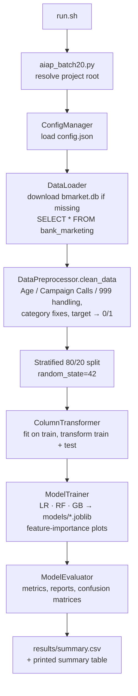

# Predicting bank term-deposit subscriptions — end-to-end ML pipeline (AIAP Batch 20 technical assessment)


[](https://colab.research.google.com/github/tantg88888/aiap20-bank-term-deposit-prediction/blob/main/eda.ipynb)

**Author:** Tan Teck Guan

This is my technical assessment for Batch 20 of the AI Singapore AI Apprenticeship Programme (AIAP). The task is to predict whether a bank client will subscribe to a term deposit (`Subscription Status`) from a direct-marketing dataset. There are two parts:

1. **Exploratory data analysis**: [`eda.ipynb`](eda.ipynb)
2. **Machine-learning pipeline**: plain Python modules in [`src/`](src/), configured by [`config.json`](config.json) and run with [`run.sh`](run.sh). GitHub Actions runs it end to end on every push.

**What the pipeline does:** it downloads the SQLite dataset, cleans it, engineers features, trains three classifiers (Logistic Regression, Random Forest and Gradient Boosting) and scores them on a stratified hold-out set. It reports accuracy, precision, recall, F1 and ROC AUC for each model. The script exits with a non-zero code if any step fails, so a broken run shows up as a failed CI check.

---

## Contents

- [Repository structure](#repository-structure)
- [How to run](#how-to-run)
- [Pipeline flow](#pipeline-flow)
- [EDA: key findings and the choices they drove](#eda-key-findings-and-the-choices-they-drove)
- [Feature processing](#feature-processing)
- [Model choice](#model-choice)
- [Evaluation](#evaluation)
- [Deployment considerations](#deployment-considerations)
- [Data](#data)

---

## Repository structure

```
.
├── .github/workflows/github-actions.yml  # CI: installs deps, runs run.sh, uploads results/
├── src/
│   ├── aiap_batch20.py      # Entry point: orchestrates load → preprocess → train → evaluate
│   ├── config_manager.py    # Loads config.json from the project root (creates a default if missing)
│   ├── data_loader.py       # Downloads bmarket.db if absent and reads the bank_marketing table
│   ├── preprocessor.py      # Cleaning, feature engineering, ColumnTransformer, stratified split
│   ├── model_trainer.py     # Trains the configured models, saves them, plots feature importances
│   └── evaluator.py         # Metrics, classification reports, confusion matrices, summary CSV
├── config.json              # All tunable parameters (features, split, model hyper-parameters, paths)
├── eda.ipynb                # Exploratory data analysis (Task 1)
├── requirements.txt         # Pinned dependencies (Python 3.11)
├── run.sh                   # Runs the pipeline (does not install anything)
└── README.md
```

These folders are created at runtime and are git-ignored:

| Folder | Contents |
|---|---|
| `data/` | `bmarket.db`, downloaded on the first run |
| `models/` | `<Model>.joblib` for each trained model |
| `results/` | `summary.csv`, `evaluation_summary.csv`, `<Model>_confusion_matrix.png`, `<Model>_feature_importance.png` |

## How to run

You need Python 3.11 (the version CI uses) and internet access on the first run, so the dataset can be downloaded.

```bash
python -m venv .venv
source .venv/bin/activate          # Windows: .venv\Scripts\activate
pip install -r requirements.txt
bash run.sh
```

`run.sh` uses `set -euo pipefail`. It moves into the project root, puts `src/` on `PYTHONPATH` and runs `src/aiap_batch20.py`. The run ends with a summary table, which is also saved to `results/summary.csv`.

**Changing parameters:** edit `config.json`. You do not need to touch any code.

| Section | Keys |
|---|---|
| `data_loader` | `db_path_relative`, `db_url`, `table_name` |
| `preprocessor` | `numerical_features`, `categorical_features`, `target_column`, `test_size` (0.2), `random_state` (42) |
| `model_trainer.models_config` | One entry per model, with its constructor keyword arguments. Supported names: `LogisticRegression`, `RandomForestClassifier`, `GradientBoostingClassifier`, `SVC`, `KNeighborsClassifier`. |
| `model_trainer.model_save_dir_relative` | Output folder for models |
| `evaluator.results_save_dir_relative` | Output folder for results |

If `config.json` is deleted, `ConfigManager` writes the same default file again on the next run.

**To run the EDA:** open `eda.ipynb` in Jupyter from the repository root, or use the Colab badge above. The first cell downloads `bmarket.db` into `data/` if it is missing.

## Pipeline flow



1. **Configuration.** The project root is taken as the parent of `src/`, so the paths work from any working directory. `config.json` is read from that root.
2. **Data loading.** If `data/bmarket.db` is missing, it is streamed from the assessment URL with a timeout, and HTTP errors are raised. The `bank_marketing` table is then read into pandas.
3. **Cleaning and feature engineering.** The steps are listed in [Feature processing](#feature-processing).
4. **Split and transform.** The data is split 80/20, stratified on the target. The `ColumnTransformer` is fitted on the training split only. It median-imputes and standard-scales the numeric columns, and one-hot encodes the categorical columns with `handle_unknown="ignore"`.
5. **Training.** Each model in `models_config` is fitted and saved with joblib. Feature importances are plotted: absolute coefficients for Logistic Regression, and `feature_importances_` for the tree ensembles.
6. **Evaluation.** Each model is scored on the hold-out set. If any model fails to train, or any metric cannot be computed, the run exits with code 1.

## EDA: key findings and the choices they drove

All numbers below come from the printed outputs in `eda.ipynb`.

| Finding | Evidence in the notebook | Pipeline choice |
|---|---|---|
| **Imbalanced target** | `Subscription Status`: 36,548 "no" out of 41,188 rows, so about **11.3 % "yes"** (4,640) | `class_weight="balanced"` for LR and RF; stratified split; recall, F1 and ROC AUC rather than accuracy |
| **Age is text and has a sentinel value** | Stored as `"57 years"`. `"150 years"` is the most frequent value (4,197 rows, about 10 %). The real ages run from 17 to 98. After cleaning, mean = 40.0 and median = 38.0. | Extract the digits, treat ages above 100 as missing, impute with the mean |
| **Many missing loan values** | `Housing Loan` has 16,399 non-null values out of 41,188 (about 60 % missing). `Personal Loan` has 37,042 non-null (about 10 % missing). Both also have an explicit `"unknown"` level. | Fill the missing values with `"unknown"`, so missingness is kept as its own category |
| **Negative call counts** | `Campaign Calls` ranges from −41 to 56 (median 2) | Take the absolute value. These look like sign errors, since the magnitudes match the positive values. |
| **999 means "never contacted"** | `Previous Contact Days`: the 25th, 50th and 75th percentiles are all 999. The real values are 0–27. | Split into `PreviouslyContacted` (a 0/1 category) and `DaysSinceLastContact` (999 becomes NaN, then median-imputed) |
| **Inconsistent category labels** | `Contact Method` has four labels: `Cell`, `cellular`, `Telephone`, `telephone` | Map them to `cellular` and `telephone` |
| **No duplicate clients** | "No duplicate Client IDs found." | Drop `Client ID`, which is an identifier and not a feature |

The notebook's bivariate plots compare subscription counts by education level, contact method and prior contact. They point towards cellular contact and previously contacted clients converting better. Its correlation heatmaps show only weak linear correlations between the numeric and loan features and the target. Linear correlation does not capture these category effects, which is one reason the pipeline includes non-linear tree ensembles.

## Feature processing

| Feature | Raw type | Issue | Processing | Model input |
|---|---|---|---|---|
| `Client ID` | int | Identifier | Dropped | — |
| `Age` | text (`"NN years"`) | `"150 years"` sentinel | Extract digits → values above 100 set to NaN → mean-imputed → `StandardScaler` | 1 scaled numeric |
| `Campaign Calls` | int | Negative values | `abs()` → `StandardScaler` | 1 scaled numeric |
| `Previous Contact Days` | int | 999 = no prior contact | Replaced by the two engineered features below (original not used) | — |
| `DaysSinceLastContact` | engineered | NaN when never contacted | Median imputation → `StandardScaler` | 1 scaled numeric |
| `PreviouslyContacted` | engineered | — | `"1"` if contacted before, else `"0"` → one-hot | 2 columns |
| `Occupation` | text | `"unknown"` level | NaN → `"unknown"` → one-hot | 12 columns |
| `Marital Status` | text | `"unknown"` level | NaN → `"unknown"` → one-hot | 4 columns |
| `Education Level` | text | `"unknown"` level | NaN → `"unknown"` → one-hot | 8 columns |
| `Credit Default` | text | Mostly `"no"` / `"unknown"` | NaN → `"unknown"` → one-hot | 3 columns |
| `Housing Loan` | text | About 60 % NULL | NULL → `"unknown"` → one-hot | 3 columns |
| `Personal Loan` | text | About 10 % NULL | NULL → `"unknown"` → one-hot | 3 columns |
| `Contact Method` | text | 4 inconsistent labels | `Cell`→`cellular`, `Telephone`→`telephone` → one-hot | 2 columns |
| `Subscription Status` | text | Target | `yes`→1, `no`→0 | target `y` |

The column counts are worked out from the category levels shown in the EDA. They come to about 40 model inputs in total. The pipeline prints the exact feature names when it runs.

Two limitations, noted honestly:

- The `Age` mean is computed on the full dataset before the train/test split. This leaks a small amount of information from the test set. Moving the imputation into the `ColumnTransformer` would fix it.
- The EDA notebook treats ages above 130 as invalid, while the pipeline uses a cutoff of 100. Both cutoffs remove exactly the same rows (the `"150 years"` sentinel), because the largest real age is 98.

## Model choice

| Model | Configured parameters | Why it is included |
|---|---|---|
| Logistic Regression | `C=1.0, solver="liblinear", class_weight="balanced", random_state=42` | A fast, interpretable linear baseline. Its coefficients can be read as feature effects. |
| Random Forest | `n_estimators=100, class_weight="balanced", random_state=42` | Captures non-linear effects and interactions between categories, is robust to outliers, and gives impurity-based importances |
| Gradient Boosting | `n_estimators=100, learning_rate=0.1, random_state=42` | Usually the strongest of the three on tabular data. It has no `class_weight` option here, so it shows what imbalance does to an unweighted model. |

All three are standard scikit-learn estimators. Other models (`SVC`, `KNeighborsClassifier`) can be added through `config.json` without code changes.

## Evaluation

The models are scored on a stratified 20 % hold-out set (about 8,238 rows). The positive class is "subscribed" (1).

| Metric | What it tells us here |
|---|---|
| **Recall** (class 1) | The share of actual subscribers that the model finds. A missed subscriber is lost revenue, so this is the main metric. |
| **Precision** (class 1) | The share of predicted subscribers who really subscribe. This drives the cost of each call. |
| **F1** (class 1) | Balances precision and recall in one number. Useful when the positive class is rare. |
| **ROC AUC** | How well the model ranks clients, independent of the decision threshold. It is useful for building a call list ordered by score. |
| Accuracy | Shown for completeness only. With 11.3 % positives, a model that always predicts "no" scores about 88.7 % accuracy and finds nobody. |

The pipeline also prints a full classification report for each model. It saves a confusion matrix and a feature-importance plot for each model to `results/`.

### Results

| Model | Accuracy | Precision | Recall | F1 | ROC AUC |
|---|---|---|---|---|---|
| Logistic Regression | 0.676 | 0.205 | **0.651** | **0.311** | 0.730 |
| Random Forest | 0.846 | 0.300 | 0.277 | 0.288 | 0.666 |
| Gradient Boosting | **0.897** | **0.647** | 0.194 | 0.299 | **0.738** |

*Positive class = subscribed ("yes"), about 11% of clients. Test set = 20% stratified hold-out. From GitHub Actions run #1 (`results/summary.csv` artifact); the pipeline prints this table at the end of every run.*

**Reading the results:**
- **Accuracy is misleading here.** A model that always says "no" would score about 0.89, so Gradient Boosting's 0.897 barely beats it.
- **Gradient Boosting** has no class weighting. It is precise (65% of the clients it flags do subscribe) but finds only 19% of subscribers.
- **Logistic Regression** with `class_weight="balanced"` finds 65% of subscribers, at the cost of many false positives (precision 0.20).
- **All three are close on F1 (0.29–0.31).** Which to deploy depends on the cost of a wasted call compared with a missed subscriber:
  - Cheap calls favour Logistic Regression for its higher recall.
  - Limited call capacity favours Gradient Boosting for its higher precision.
- **ROC AUC around 0.73** means the available features carry only modest signal.
- **Next steps:**
  - tune the decision threshold on predicted probabilities instead of using 0.5;
  - weight or resample for Gradient Boosting;
  - compare with a precision-recall AUC.

**How to read the results.** The two class-weighted models (LR and RF) should trade some precision for higher recall. Unweighted Gradient Boosting at the default 0.5 threshold will tend to be conservative, with high precision and lower recall. If so, its ROC AUC is the fairer basis for comparison, and its threshold should be tuned before it is used.

## Deployment considerations

- **Save one artifact.** Today the models are saved but the fitted `ColumnTransformer` is not. For serving, wrap the preprocessing and the model in a single `sklearn.pipeline.Pipeline` and save that. The cleaning rules in `clean_data` should move into transformers too, so the same logic runs at inference time.
- **Choose the threshold for the business.** Set the decision threshold from the cost of a call compared with the value of a deposit, for example "maximise recall subject to precision ≥ X". For a ranked call list, use the predicted probabilities directly, and calibrate them first if they will be shown as likelihoods.
- **Validate input data.** The dataset already contains sentinels (`"150 years"`, 999), sign errors and inconsistent labels. Schema and range checks before scoring (allowed category levels, numeric ranges) will catch upstream changes before they quietly shift predictions.
- **Monitor and retrain.** Watch for changes in the input data (for example, the category mix) and in the subscription rate. Retrain on fresh campaign outcomes, and track recall and precision on labelled follow-ups.
- **Serve in batches.** Campaign targeting is naturally a batch job that scores the client base before a campaign. A scheduled job that writes scores to a table is simpler and cheaper than a real-time API.
- **Governance.** The inputs include age and marital status, so check that performance is similar across groups before use. Handle client data according to the bank's data-protection policy.
- **Reproducibility.** Dependencies are pinned, seeds are fixed in `config.json`, and CI runs the full pipeline on every push.

## Data

The dataset (`bmarket.db`, table `bank_marketing`, 41,188 rows × 12 columns) was provided by AI Singapore for this assessment. It is **not redistributed** in this repository: `data/` and `*.db` are git-ignored. The pipeline and the notebook download it at runtime from the URL set in `config.json`. If that URL is ever taken down, place the file manually at `data/bmarket.db`.
